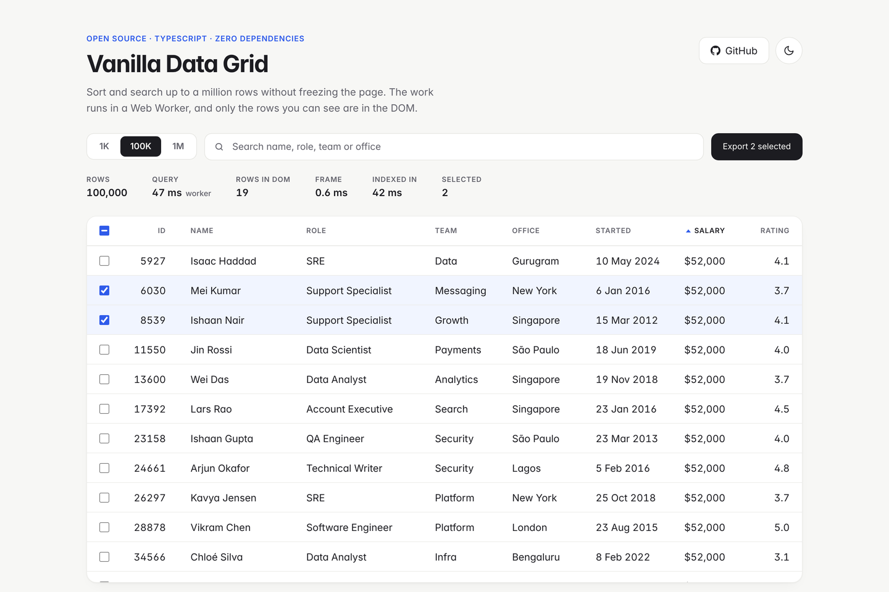

# Vanilla Data Grid

[](https://github.com/itsjxi/vanilla-data-grid/actions/workflows/ci.yml)

A dependency-free data grid in TypeScript that sorts and searches **a million rows without freezing the page**. Only the rows on screen are in the DOM, sorting and search run in a Web Worker, and the grid follows the WAI-ARIA grid pattern for keyboard and screen-reader users.

**Live demo:** https://gridtable2023.netlify.app — switch between 1K, 100K and 1M rows and watch the live timings.



## What it does

- **Virtual scrolling.** About 25–30 row elements exist at any time, whatever the row count. They're reused as you scroll, and only cells whose text changed are rewritten. Above ~8M px of content the scrollbar is compressed, because browsers cap element height (Firefox at ~17.9M px), so a million rows still scroll pixel-perfectly to the last row.
- **Sort and search off the main thread.** Tables over 20K rows are queried in a Web Worker. Only one query is in flight at a time: while it runs, newer keystrokes replace each other in a one-slot queue, so a stale answer can never overwrite a newer one.
- **Columnar, dictionary-encoded data.** Each text value is stored once with a small integer id per row, the way Arrow and Parquet do it. The worker takes over the typed arrays for free (transfer, not copy). Search tests each *distinct* value once, and sorting ranks the distinct values instead of a million strings.
- **Fast, stable sorting.** Sort keys are packed as `rank × 2²¹ + rowIndex` into a `Float64Array`, so the engine can use the native numeric sort with no comparator callback. Ties keep their original order. Text sorts with `Intl.Collator` (case-insensitive, `Item 2` before `Item 10`), and currency strings sort as numbers. Empty values go last in both directions.
- **Loading never blocks a frame for long.** A million rows are prepared in ~12 ms slices that yield to the browser, and newer data cancels a load that's still running.
- **Accessible.** It follows the WAI-ARIA grid pattern (`role="grid"`, `aria-rowcount`/`aria-rowindex` for the full table, `aria-sort`, `aria-selected`, `aria-multiselectable`). Focus stays on the grid and the active cell is tracked with `aria-activedescendant`, which keeps working when virtualization recycles the cell's element. Sorting, search results and selections are announced in a polite live region. The demo has zero axe-core violations in both themes.
- **Keyboard:** arrow keys, Home/End, Ctrl+Home/End, PageUp/PageDown, Enter on a header to sort, Space to select, Shift+Space for ranges, Ctrl/⌘+A to select every matching row.
- **Selection that behaves.** Rows are tracked by identity, so selections survive sorting and search. Select-all only selects rows that match the current search, and the header checkbox shows a mixed state.
- **Safe by construction.** Cells are written with `textContent`, never `innerHTML`. CSV export follows RFC 4180 and neutralises spreadsheet formulas (`=`, `+`, `-`, `@`) to block CSV injection.

## Performance

`npm run bench` runs the query engine on 1,000,000 generated employee rows (2,376 distinct names, 14 roles, 10 teams, 12 offices). Medians on a 4-core Linux VM, Node 22:

| Operation | Time |
| --- | ---: |
| Prepare (encode) the table, main thread, once per data load | 267 ms, time-sliced |
| First sort, text column (name) | 103 ms |
| First sort, number column (salary) | 262 ms |
| First sort, unique per row (id) | 214 ms |
| Re-sort the same column (cached) | 0.1 ms |
| Search, 1 term | 6.6 ms |
| Search, 2 terms on a sorted view | 6.7 ms |
| *Naive `Array#sort` with `localeCompare` on names, for comparison* | *648 ms* |

In headless Chromium, with the browser demo at 1M rows:

- The longest main-thread task during the whole load was **55 ms**; handing the table to the worker took **under 1 ms**.
- Sorting and searching produced **no long tasks** on the main thread.
- Programmatic scrolling held **16.7 ms per frame** (60 fps) with **31 row elements** in the DOM.

The demo's status line shows live numbers on your machine, and the grid adds `vdg:*` User Timing entries to the DevTools Performance panel.

## Usage

```ts
import { createDataGrid, type Column } from 'vanilla-data-grid';
import 'vanilla-data-grid/style.css';

type Person = { id: number; name: string; office: string; salary: number; started: string };

const columns: Column<Person>[] = [
  { field: 'id', title: 'ID', type: 'number', width: 90 },
  { field: 'name', title: 'Name' },
  { field: 'office', title: 'Office' },
  { field: 'salary', title: 'Salary', type: 'number', format: (v) => `$${v.toLocaleString()}` },
  { field: 'started', title: 'Started', type: 'date' },
];

const grid = createDataGrid(document.querySelector('#grid')!, {
  columns,
  rows,                       // any array of plain objects; never mutated
  ariaLabel: 'Employees',
  selectable: true,
  onStats: (s) => console.log(`${s.matching} rows, query ${s.queryMs} ms on the ${s.where}`),
});

grid.setSearch('pune');
grid.setSort({ field: 'salary', direction: 'desc' });
grid.getSelectedRows();
grid.exportCsv({ selectedOnly: true });
```

| Option | Default | |
| --- | --- | --- |
| `rowHeight` | `44` | Fixed row height in px |
| `selectable` | `false` | Checkbox column and keyboard selection |
| `worker` | `'auto'` | `'auto'` uses a worker from `workerThreshold` rows (20,000); `'always'` / `'never'` |
| `rowLabel` | first column | Words used for a row in announcements and checkbox labels |
| `onStats`, `onSelectionChange` | | Callbacks |

Give the container a fixed height (for example `height: 600px`); the grid fills it and scrolls inside. Column `type` is `'text'` (default), `'number'` (also parses `"$1,200"`) or `'date'`. Text columns are searchable by default; set `searchable: true` to search a number or date column too. Theme it with the `--vdg-*` CSS custom properties, or set `data-theme="dark"` on any ancestor.

## How it's built

```
src/
  core/
    encode.ts       rows → columnar, dictionary-encoded table (time-sliced)
    engine.ts       QueryEngine: rank, sort (packed keys), search (per distinct value)
    queryClient.ts  main thread ↔ worker; one query in flight, latest wins, crash fallback
    virtualizer.ts  pure maths: visible window, compressed scrolling, scroll-into-view
    csv.ts          RFC 4180 export with formula guards
  worker/           the worker is a thin wrapper around QueryEngine
  grid/DataGrid.ts  DOM: row recycling, ARIA grid, keyboard, selection, live region
demo/               the demo page and seeded data generator
```

The engine and virtualizer are pure functions with no DOM, so they're unit-tested directly. The grid is tested through the DOM, with a fake worker standing in where timing matters.

## Testing

```bash
npm test          # Vitest + jsdom: 34 tests
npm run lint      # ESLint + typescript-eslint, zero warnings
npm run typecheck # strict TypeScript
npm run bench     # engine benchmark
```

The tests cover:
- sorting rules: numbers in strings, stability, empties last, collator ties
- accent-insensitive AND search that never matches across cells
- latest-wins worker messaging, including stale answers, a replaced table and a crashed worker
- virtual window maths, including compressed scrolling
- the grid itself: row recycling, every keyboard command, selection with search and sort, CSV formula guards, HTML injection, cancelling a load that's still running, and a safety cap when the container has no height

CI runs lint, type-check, tests and both builds on every push.

## Scripts

| Script | |
| --- | --- |
| `npm run dev` | Demo with hot reload |
| `npm run build` | Type-check and build the demo to `dist-demo/` |
| `npm run build:lib` | Build the library to `dist/` (ES module, CSS, type declarations) |

## Trade-offs and what's next

- **Fixed row height.** Variable heights would need measured offsets and a prefix-sum lookup. Fixed heights keep scrolling O(1).
- **Substring search, not fuzzy.** It's predictable and fast with dictionary encoding. Fuzzy ranking would be a separate, scored mode.
- **Next:** column resizing and reordering, inline editing, a SharedArrayBuffer path for live-updating data, and a Playwright suite in CI.

## History

This started in 2023 as an MVC table, then became a single class-based component. Version 2 is a rewrite in TypeScript around virtualization, a worker query engine and the ARIA grid pattern. The earlier versions are in the git history.

## License

MIT
